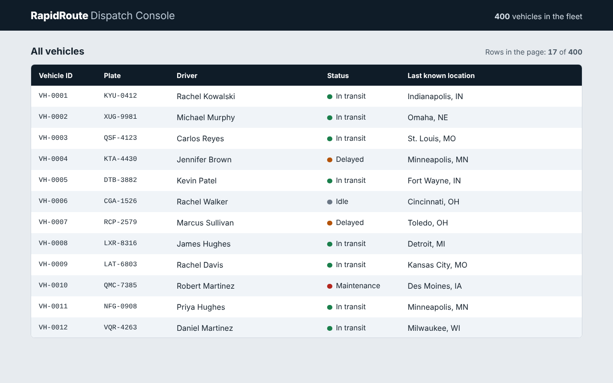

# RapidRoute Dispatch Console

Live dispatch console for RapidRoute Logistics, a regional delivery provider with a fleet of 400 trucks. This is **Task 1**: a virtualized vehicle list that stays smooth no matter how long the list is.



## What it does
- A Node script generates 400 vehicle records (id, plate, driver, status, last known location).
- The list only puts the rows you can see (plus a few spare rows above and below) into the page. Scrolling reuses the same row elements, so the page always holds about 17 to 21 rows instead of 400.
- Rows are laid out with CSS Grid and have alternating colors. The header stays in place while you scroll.
- Status is shown with a colored dot and the status in words, so it never relies on color alone.

## Run it
```bash
npm install
npm run generate     # writes src/data/vehicles.json (400 vehicles, same output every run)
npm run dev          # opens the console at http://localhost:5173
```
Other scripts: `npm run check:data` (validates the JSON), `npm run lint`, `npm run build`.

## Project layout
| Path | Purpose |
|---|---|
| `scripts/generateData.js` | Creates `src/data/vehicles.json` with 400 entries |
| `scripts/checkData.js` | Checks the JSON: 400 rows, unique ids and plates, valid statuses |
| `src/virtualList.js` | The virtualization code (fixed row height, row reuse) |
| `src/main.js` | Builds the rows and connects the data to the list |
| `src/style.css` | Layout and styling (CSS Grid for rows) |
| `.github/workflows/ci.yml` | Runs lint, data check and build on every push |
| `scripts/mockServer.js` | Mock WebSocket server (Node + `ws`), one random vehicle update every 5 seconds |
| `src/mockPositions.js` | Makes the fake position updates; shared by the server and the in-page mock |
| `src/liveFeed.js` | Native WebSocket client with the in-page fallback |
| `src/liveStore.js` | Applies an update to the vehicle record and tells subscribers (the detail panel will use this) |
| `src/filters.js` | Filter, sort and URL logic (no DOM code, so it can be unit tested) |
| `tests/filters.test.js` | Jest unit tests for `src/filters.js` |
| `src/detailPanel.js` | The vehicle detail side panel (open, close, focus trap, live coordinates) |
| `src/navigation.js` | Works out which row gets focus after an arrow, Page or Home/End key |
| `tests/navigation.test.js` | Jest tests for the keyboard navigation logic |
| `tests/liveStore.test.js` | Jest tests for the live store (updates and subscriptions) |

## How the virtualization works
1. A tall empty "spacer" gives the scrollbar the height of all 400 rows (400 x 44 px).
2. On scroll, the code works out which rows are in view: `first = floor(scrollTop / rowHeight)`.
3. It shows those rows plus 4 spare rows above and below, and moves the row container to the right place with `transform: translateY(...)`.
4. Row elements are reused: only their text changes. Work is done once per animation frame.

## How to check that only visible rows are rendered
1. Open the console in Chrome DevTools (F12). Each time the visible window changes, it logs something like
   `[virtual-list] vehicles 1 to 17 rendered (17 of 400 rows in the DOM)`.
2. The text above the list also shows `Rows in the page: 17 of 400`.
3. In the Elements tab, the `.rows` element holds about 17 to 21 children, never 400.

## Performance note
**How I measured:** I built the production version (`npm run build`, then `npm run preview`) and opened it in Chrome on Windows. In Chrome DevTools I recorded about 9.6 seconds of scrolling in the Performance tab, and I also watched the live "Frame Rendering Stats" meter while scrolling the list quickly.

**Results**
- Frame rate while scrolling: about 135 fps (about 7 ms per frame) on my high-refresh screen. This is well above the 55 fps target.
- Rows in the page while scrolling: 20 to 22 of 400 (from the console logs).
- My app's own JavaScript used about 47 ms of main-thread time over the whole recording.
- Scripting 423 ms, Rendering 1,304 ms and Painting 424 ms out of 9,590 ms. The main thread was idle about 75% of the time.
- Layout shift (CLS): 0.

**Conclusion:** Scrolling stays smooth because only about 20 rows exist in the page at any time, and the rows are reused instead of recreated.

## Accessibility
- The list is a keyboard-focusable region: use Tab to reach it, then arrow keys, Page Up and Page Down to scroll.
- Table roles and `aria-rowindex` / `aria-rowcount` tell screen readers there are 400 rows even though only some are on the page.
- Skip link, visible focus outlines and text colors with enough contrast.


# README for Task 2

### Live position updates (Task 2)

A mock WebSocket server sends the new position of one random vehicle every 5 seconds. The page updates only that vehicle's row. The rest of the list is not re-rendered.

### Run it
Use two terminals:
```bash
npm run mock-server   # ws://localhost:8787, one update every 5 seconds
npm run dev           # the console at http://localhost:5173
npm test (runs the unit tests)
```
`npm run dev` connects to the mock server automatically. The "Live feed" line above the list shows `mock server` when it is connected.

If the server is not running (for example on the deployed Netlify site), the page falls back to an in-page mock that sends the same messages, so the live feed still works.

To speed things up for testing:
- With the mock server, set the interval when you start it. In PowerShell: `$env:INTERVAL_MS=200; npm run mock-server`.
- For the in-page mock (`npm run preview` or the deployed site), add `?interval=200` to the URL.

### How it works
1. `scripts/mockServer.js` (Node and the `ws` package) sends `{ type: "position", vehicleId, lat, lng, ts }` for one random vehicle on a timer. `src/mockPositions.js` makes these messages and is shared with the in-page mock.
2. `src/liveFeed.js` opens a native WebSocket and calls `onUpdate` for each message. If the server cannot be reached, it starts the in-page mock instead.
3. `src/liveStore.js` writes the new coordinates into that vehicle's record and returns its index.
4. `list.refreshRow(index)` in `src/virtualList.js` checks whether that vehicle is one of the ~16 to 21 rows currently in the page. If it is, only the coordinates text in that one row changes, and the row flashes yellow. If it is not, no DOM changes, and the new position shows when the vehicle scrolls into view.

This project uses plain JavaScript, not React, so `React.memo` is not needed. The row is updated directly in the DOM, and the list is never re-bound on an update.

### How I checked it
I watched the browser console. Every update prints one line, for example:

`[live] VH-0012 -> 42.8560, -88.0177 | 1 row updated in 0.30 ms (avg 0.02 ms) | full list re-renders since load: 1`

- A visible row updated in 0.30 ms, and the average over all updates was 0.02 ms. Both are under the 5 ms target.
- `full list re-renders since load` stayed at 1 (the first render) while updates kept arriving, so the list was never re-rendered.
- Only about 16 of 400 vehicles are in the page, so most updates say `not on screen, data only`. That is expected.

### Limits
- The detail panel is part of a later task. `liveStore.subscribe()` is ready so the panel can show the same live coordinates when it exists.
- The deployed site uses the in-page mock, because Netlify cannot run the Node server.

# README for Task 3
## Filter and sort with URL state (Task 3)

Above the list there is a **Status** dropdown, a **Driver** search box and a **Sort by** dropdown (vehicle ID, driver A to Z, driver Z to A, or last update, newest first). Changing any of them updates the list straight away and also updates the address bar, for example:

`?status=delayed&driver=brown&sort=driver`

Reloading the page, bookmarking it or sharing the link brings back the same view. Values that are the default (all statuses, no driver text, sort by ID) are left out of the URL, so the unfiltered page has a clean URL with no query string.

### How it works
1. `src/filters.js` holds three small functions: `parseFilters` (URL to filter object), `serializeFilters` (filter object to URL) and `applyFilters` (filter and sort the vehicles). Anything in the URL that is not recognised (for example `?status=flying`) falls back to the default.
2. When the page loads, `main.js` reads `window.location.search` with `parseFilters`, builds the list from it and sets the controls to match.
3. When a control changes, `main.js` builds a new filter object, writes it to the URL with the History API (`URLSearchParams` and `history.pushState`) and calls `list.setItems()` on the virtualized list. The same pooled row elements are reused, so only about 16 to 21 rows exist in the page whatever the filter result.
4. Choosing from a dropdown adds a browser history entry, so the Back button undoes it. Typing in the driver box replaces the current entry instead, so one search does not create one history entry per letter. The `popstate` event re-reads the URL on Back and Forward.
5. If nothing matches, the list shows "No vehicles match these filters" and a **Clear filters** button resets everything.

The task suggests React Router and `useEffect`. This project uses plain JavaScript, so the same job is done with `URLSearchParams` and the History API.

Live position updates still work while a filter is active. The list keeps its current order until a control is changed, so rows do not jump around while someone is reading them.

### Tests
`npm test` runs 13 Jest tests in `tests/filters.test.js`. They cover filtering by status, driver search (case, spaces and part of a name), combined filters, no matches, all sort options, not changing the original array, reading the URL (including bad values) and writing the URL (including a round trip). The tests also run in GitHub Actions on every push.

# README for Task 4
## Detail side panel and keyboard navigation (Task 4)

Clicking a vehicle row, or pressing **Enter** on it, opens a side panel that slides in from the right and shows all the vehicle's fields: ID, plate, driver, status, last known location, latitude, longitude and last update time.

### Keyboard use
| Key | What it does |
|---|---|
| Tab | Moves into the list (one tab stop for the whole list) |
| Up / Down | Moves focus to the previous / next vehicle |
| Page Up / Page Down, Home / End | Jump a page, or to the first / last vehicle |
| Enter or Space | Opens the details panel for the focused vehicle |
| Esc, or the Close button | Closes the panel and puts focus back on the vehicle you opened it from |

### How it works
- **Roving tabindex.** Only one row (the active one) has `tabindex="0"`, all others have `-1`. The list is one Tab stop, and the arrow keys move between rows. This matches the ARIA guidance for composite widgets.
- **Keyboard and virtualization.** Only about 21 rows exist in the page, so `list.revealIndex()` scrolls just enough to bring the next row into view and draws it before it gets focus. Focus is moved with `focus({ preventScroll: true })`, so the browser never makes the list jump.
- **Scroll position is kept.** The panel is fixed on top of the page, so opening or closing it does not change the list's width or scroll position. On close, focus goes back to the row that opened it.
- **Focus trap.** The panel has `role="dialog"`, `aria-modal="true"` and `aria-labelledby` (its title). While it is open, everything else on the page is made `inert`, and Tab / Shift+Tab are kept inside the panel.
- **Labels.** The Close button has visible text, the list has a text description (the keyboard hint above it), and every panel field is a `<dt>` / `<dd>` pair.
- **Live updates.** The panel subscribes to the live store (`store.subscribe`). When a position update arrives for the vehicle shown in the panel, only its latitude, longitude and last-update text change. Updates for other vehicles are ignored.
- **Reduced motion.** The slide-in animation is turned off if the user has asked their system for reduced motion.

### Testing and findings
- `npm test` runs the Jest tests, including 5 for the keyboard navigation logic and 3 for the live store.
- I tested the keyboard flow by hand: Tab into the list, Up / Down through rows (including past the 21 rows in the page), Home / End, Enter to open, Tab and Shift+Tab inside the panel, Esc to close, and checked that the scroll position and the focused vehicle were the same after closing.
- An automated axe-core run (version 4.14.0) on the list and on the open panel found one issue: `role="dialog"` is not allowed on an `<aside>` element. I changed the panel to a `<div>`, and the same run then reported 0 violations in both states.
- **axe browser extension result (0 issues):**

# README for Task 5
## Offline banner, action queue, performance profiling and final handover (Task 5)

### Live demo
**https://exquisite-kheer-f7ac2a.netlify.app/**

### What was added

#### Offline banner
When the browser goes offline (`navigator.onLine` becomes `false`), a warning banner slides in at the top of the page:

> ⚠ You are offline — actions will sync when back online

The banner uses `role="alert"` and `aria-live="assertive"` so screen readers announce it immediately. When the connection comes back, the banner briefly turns green and shows how many actions were synced, then disappears after 3 seconds.

#### Action queue
Filter, sort and search changes made while offline are stored in a queue (`src/offlineQueue.js`). Each entry is a snapshot of the full filter state at the time of the change. When the connection restores:
1. The queued actions are flushed.
2. The latest filter state is re-applied to the list.
3. The banner shows "Back online — synced N actions".

This means the app stays fully usable while offline (the 400 vehicles are already in memory), and no user action is lost.

#### Performance optimisations
- **Favicon:** An inline SVG favicon (🚚) was added so Lighthouse does not flag a missing favicon.
- **Theme colour:** `<meta name="theme-color">` was added, matching the topbar colour `#0f1c28`.
- **Existing optimisations** that already keep scores high: virtualized list (~20 DOM rows out of 400), no third-party scripts, CSS minified by Vite, `will-change` on the scrolling row container, `requestAnimationFrame` debouncing, and `font-variant-numeric: tabular-nums` to prevent layout jitter.

#### Lighthouse scores
| Category | Score |
|---|---|
| Performance | 98 |
| Accessibility | 95 |
| Best Practices | 96 |
| SEO | 100 |

The full report is in [`docs/lighthouse-report.json`](docs/lighthouse-report.json).

### How to test the offline banner
1. Open the app in Chrome.
2. Open DevTools (F12) → **Network** tab.
3. Check the **Offline** checkbox.
4. The amber banner appears at the top: "You are offline — actions will sync when back online".
5. Change a filter (for example, set Status to "Delayed"). The list updates locally and the action is queued.
6. Uncheck the **Offline** checkbox.
7. The banner turns green: "Back online — synced 1 action", then disappears after 3 seconds.

### How to run a Lighthouse audit yourself
1. Open **https://exquisite-kheer-f7ac2a.netlify.app/** in Chrome.
2. Open DevTools (F12) → **Lighthouse** tab.
3. Select categories: Performance, Accessibility, Best Practices, SEO.
4. Choose "Desktop" (or "Mobile" if you prefer).
5. Click **Analyze page load**.
6. To save the report: click the **export** icon (↓) → **Save as JSON** → save to `docs/lighthouse-report.json`.

### Setup, build, test and deploy

```bash
# Clone and install
git clone https://github.com/Hashim-rajahh/rapidroute-dispatch-console.git
cd rapidroute-dispatch-console
npm install

# Generate vehicle data (already committed, only needed if regenerating)
npm run generate

# Development server
npm run dev          # http://localhost:5173

# Run tests
npm test

# Lint
npm run lint

# Production build
npm run build
npm run preview      # preview the production build locally

# Mock WebSocket server (optional, for local live updates)
npm run mock-server  # ws://localhost:8787
```

### Deployment
The app is deployed on **Netlify**. Every push to `main` triggers an automatic build and deploy via the `netlify.toml` configuration:
- Build command: `npm run build`
- Publish directory: `dist`
- Node version: 22

### Project layout (complete)
| Path | Purpose |
|---|---|
| `src/main.js` | Entry point: wires up the list, filters, panel, live feed and offline logic |
| `src/virtualList.js` | Fixed-height list virtualizer (row pooling, scroll-driven rendering) |
| `src/filters.js` | Pure filter/sort/URL logic (no DOM code) |
| `src/navigation.js` | Keyboard navigation index calculations |
| `src/detailPanel.js` | Vehicle detail side panel (modal dialog) |
| `src/liveFeed.js` | WebSocket client with in-page mock fallback |
| `src/liveStore.js` | Applies live position updates and notifies subscribers |
| `src/offlineQueue.js` | Offline action queue (Task 5) |
| `src/mockPositions.js` | Generates fake GPS pings (shared by server and in-page mock) |
| `src/statuses.js` | Single source of truth for vehicle status values |
| `src/fpsMeter.js` | Optional on-screen FPS counter (`?fps` in URL) |
| `src/style.css` | All styles including the offline banner |
| `src/data/vehicles.json` | 400 generated vehicle records |
| `scripts/generateData.js` | Generates `vehicles.json` with a fixed seed |
| `scripts/checkData.js` | Validates the JSON (400 rows, unique IDs, valid statuses) |
| `scripts/mockServer.js` | Mock WebSocket server for local development |
| `tests/filters.test.js` | Unit tests for filter, sort and URL logic |
| `tests/navigation.test.js` | Unit tests for keyboard navigation |
| `tests/liveStore.test.js` | Unit tests for the live store |
| `tests/offlineQueue.test.js` | Unit tests for the offline action queue (Task 5) |
| `docs/lighthouse-report.json` | Lighthouse performance report |
| `.github/workflows/ci.yml` | CI pipeline: lint, data check, test, build |
| `netlify.toml` | Netlify build and header configuration |
